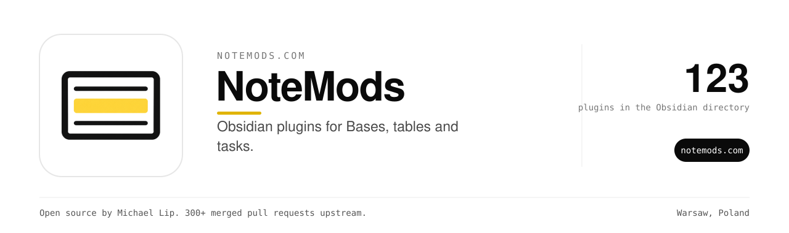

NoteMods builds Obsidian plugins that fix one specific thing well.
123 of them are listed in the Obsidian community directory. Together they have 8,000+ downloads.
Every plugin works offline and keeps your vault on your machine.

### Most used

| Plugin | What it does | Downloads |
| --- | --- | --- |
| [Callout Table Footnotes](https://github.com/theluckystrike/callout-table-footnotes) | Shows footnotes as numbered links inside callouts and table cells. | 602 |
| [Search Operators](https://github.com/theluckystrike/search-operators) | Search by created date, modified date, links, tag and path. | 508 |
| [Bases Filter Switches](https://github.com/theluckystrike/bases-filter-switches) | One-click switches that turn saved base filters on and off. | 372 |
| [Bases Freeze Panes](https://github.com/theluckystrike/bases-freeze-panes) | Keeps the header row and first columns in view while you scroll. | 357 |
| [Bases Link Graph](https://github.com/theluckystrike/bases-link-graph) | Draws the notes a base selects as a graph you can click. | 356 |

### Find a plugin

Browse all plugins by category at [notemods.com](https://notemods.com).
Install any of them from Settings, Community plugins, Browse. Search for the plugin name.

### Report a bug

Open an issue in the plugin's repository. Include your Obsidian version and the steps that cause it.
Questions go to hello@notemods.com.

### Repositories

| Repository | What it does |
| --- | --- |
| [lockfile-upgrade-notes](https://github.com/notemods/lockfile-upgrade-notes) | Compare two npm lockfiles and save a note with package additions, removals, and version changes. |
| [bases-row-deltas](https://github.com/notemods/bases-row-deltas) | Show each number value and its change from the prior row in each Bases group. |
| [csv-formula-shield](https://github.com/notemods/csv-formula-shield) | Find formula prefixes in CSV cells and write a separate escaped copy. |
| [task-id-audit](https://github.com/notemods/task-id-audit) | Find duplicate task IDs, missing dependency targets, and dependency cycles. |
| [task-query-undo](https://github.com/notemods/task-query-undo) | Restore a recent checkbox change while keeping later text edits. |
| [notemods-ci-shots](https://github.com/notemods/notemods-ci-shots) | CI screenshots and smoke tests of NoteMods Obsidian plugins in real Obsidian on Linux |
| [notemods-theme-academic-paper](https://github.com/notemods/notemods-theme-academic-paper) | Paper style headings and ruled tables for your essays and literature reviews. |
| [notemods-theme-aegis-contrast](https://github.com/notemods/notemods-theme-aegis-contrast) | Strong text contrast, ruled headings, and thick focus outlines for your notes. |
| [notemods-theme-api-reference](https://github.com/notemods/notemods-theme-api-reference) | Documentation layouts for your endpoint notes, settings, and function references. |
| [notemods-theme-citation-notes](https://github.com/notemods/notemods-theme-citation-notes) | Index card layouts for your literature notes and quotations. |
| [notemods-theme-code-notebook](https://github.com/notemods/notemods-theme-code-notebook) | Serif prose and code cells for your annotated snippets. |
| [notemods-theme-concept-weave](https://github.com/notemods/notemods-theme-concept-weave) | Node markers and list connectors for your concept notes. |
| [notemods-theme-concordance](https://github.com/notemods/notemods-theme-concordance) | Index layouts and dotted rules for your maps of content. |
| [notemods-theme-drafting-room](https://github.com/notemods/notemods-theme-drafting-room) | A quiet serif page for your long drafts. |
| [notemods-theme-ember-dim](https://github.com/notemods/notemods-theme-ember-dim) | Warm surfaces and restrained headings for your notes in dim rooms. |

25 more repositories

| Repository | What it does |
| --- | --- |
| [notemods-theme-field-notebook](https://github.com/notemods/notemods-theme-field-notebook) | Ruled paper surfaces and specimen labels for your field notes. |
| [notemods-theme-horizon-weekly](https://github.com/notemods/notemods-theme-horizon-weekly) | Spaced tasks and timetable tables for your weekly plans. |
| [notemods-theme-language-learning](https://github.com/notemods/notemods-theme-language-learning) | Two tone sections for your vocabulary notes and dialogue practice. |
| [notemods-theme-ledger-task](https://github.com/notemods/notemods-theme-ledger-task) | Ledger rules and larger checkboxes for your daily task lists. |
| [notemods-theme-lexicon](https://github.com/notemods/notemods-theme-lexicon) | Dictionary layouts for your terms, definitions, and references. |
| [notemods-theme-minute-meeting](https://github.com/notemods/notemods-theme-minute-meeting) | Speaker blocks and action controls for your meeting notes. |
| [notemods-theme-morning-pages](https://github.com/notemods/notemods-theme-morning-pages) | Soft surfaces and serif headings for your daily journal. |
| [notemods-theme-open-hand](https://github.com/notemods/notemods-theme-open-hand) | Larger controls and open spacing for your notes. |
| [notemods-theme-ops-compact](https://github.com/notemods/notemods-theme-ops-compact) | Dense tables and compact controls for your operations notes. |
| [notemods-theme-precedent](https://github.com/notemods/notemods-theme-precedent) | Timeline rules and status callouts for your decision records. |
| [notemods-theme-quiet-ledger](https://github.com/notemods/notemods-theme-quiet-ledger) | Serif text and quiet surfaces for long reading sessions. |
| [notemods-theme-reading-broadsheet](https://github.com/notemods/notemods-theme-reading-broadsheet) | Newspaper typography and column layouts for your digests and daily briefs. |
| [notemods-theme-reading-compendium](https://github.com/notemods/notemods-theme-reading-compendium) | Compact serif text and reference lists for your manuals and specifications. |
| [notemods-theme-reading-grandview](https://github.com/notemods/notemods-theme-reading-grandview) | Larger text and open line spacing for your reading notes. |
| [notemods-theme-reading-polyglot](https://github.com/notemods/notemods-theme-reading-polyglot) | Script aware font stacks for notes that contain multiple languages. |
| [notemods-theme-reading-quarto](https://github.com/notemods/notemods-theme-reading-quarto) | Narrow serif pages and indented prose for your essays and chapters. |
| [notemods-theme-red-pen](https://github.com/notemods/notemods-theme-red-pen) | Crimson rules and margin callouts for your editorial notes. |
| [notemods-theme-revision-cards](https://github.com/notemods/notemods-theme-revision-cards) | Question and answer styling for your study notes. |
| [notemods-theme-rhizome](https://github.com/notemods/notemods-theme-rhizome) | Link markers and branching list rules for your growing note collection. |
| [notemods-theme-schematic-draft](https://github.com/notemods/notemods-theme-schematic-draft) | Drafting grids and ruled edges for your diagram notes. |
| [notemods-theme-shape-first](https://github.com/notemods/notemods-theme-shape-first) | Border styles and heading shapes help you identify structure without relying on colour. |
| [notemods-theme-slugline](https://github.com/notemods/notemods-theme-slugline) | Monospace text and scene headings for your screenplay notes. |
| [notemods-theme-trellis](https://github.com/notemods/notemods-theme-trellis) | Heading numbers and list guides for your structured outlines. |
| [notemods-theme-verdict-decision](https://github.com/notemods/notemods-theme-verdict-decision) | Stamped callouts and ledger tables for your decision logs. |
| [zkn3-archive-import](https://github.com/notemods/zkn3-archive-import) | Convert version 3.8 Zettelkasten archives into notes with keywords, links, and note sequences. |

### Sponsor this work

Everything here is free to use. Sponsoring Michael on GitHub pays for the servers, the AI API bills and the hours behind each fix across 12 organizations and 1,800+ public repositories. It starts at $3 a month.

### More open source from the same maintainer

<table><tr><td align="center" width="9%"><a href="https://github.com/zovo-one"> Zovo</a></td><td align="center" width="9%"><a href="https://github.com/ml0x-com"> ml0x</a></td><td align="center" width="9%"><a href="https://github.com/toolsthatrank"> ToolsThatRank</a></td><td align="center" width="9%"><a href="https://github.com/BeLikeNative"> BeLikeNative</a></td><td align="center" width="9%"><a href="https://github.com/handsofflinks"> handsofflinks</a></td><td align="center" width="9%"><a href="https://github.com/ingredientcalculator"> Ingredient Calculator</a></td><td align="center" width="9%"><a href="https://github.com/lakelevelnow"> LakeLevelNow</a></td><td align="center" width="9%"><a href="https://github.com/seeninaianswers"> Seen in AI Answers</a></td><td align="center" width="9%"><a href="https://github.com/makeroll"> MakeRoll</a></td><td align="center" width="9%"><a href="https://github.com/aiwebsitepipeline"> AI Website Pipeline</a></td><td align="center" width="9%"><a href="https://github.com/worthmyclaim"> WorthMyClaim</a></td></tr></table>

### Maintainer

Built and maintained by [Michael Lip](https://github.com/theluckystrike) in Warsaw, Poland.
He also fixes bugs in projects he uses. He has 300+ merged pull requests in 200+ outside repositories, including [urllib3](https://github.com/urllib3/urllib3/pull/5330), [Appium](https://github.com/appium/appium/pull/22911), [Prefect](https://github.com/PrefectHQ/prefect/pull/21916) and [Google Chrome extension samples](https://github.com/GoogleChrome/chrome-extensions-samples/pull/1629).
Need an engineer for your own product or AI agent? Send a written brief at [axdale.com](https://www.axdale.com/?utm_source=github&utm_medium=org&utm_campaign=hire&utm_content=notemods).
